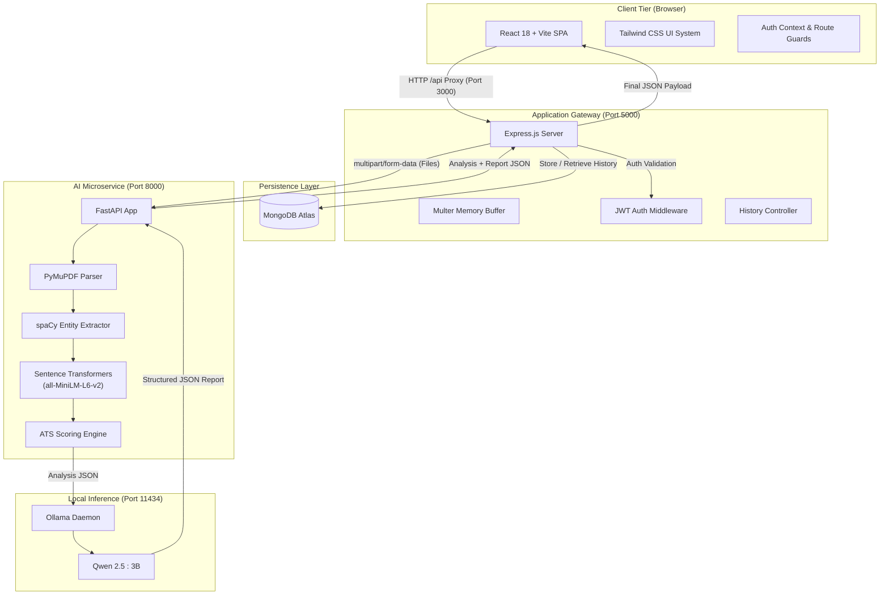

<div align="center">

# 🎯 Smart Resume Analyser

**AI-Powered ATS Optimization, Semantic Alignment & Local LLM Career Improvement Engine**

[](https://react.dev/)
[](https://www.typescriptlang.org/)
[](https://vitejs.dev/)
[](https://tailwindcss.com/)
[](https://nodejs.org/)
[](https://expressjs.com/)
[](https://www.mongodb.com/)
[](https://fastapi.tiangolo.com/)
[](https://www.python.org/)
[](https://huggingface.co/sentence-transformers/all-MiniLM-L6-v2)
[](https://ollama.ai/)
[](https://opensource.org/licenses/ISC)

<br />

<p align="center">
  <b>Smart Resume Analyser</b> is an end-to-end career intelligence platform that bridges the gap between job seekers and enterprise Applicant Tracking Systems (ATS). By synthesizing natural language document parsing, Sentence Transformer semantic embeddings, rule-based qualification matching, and privacy-preserving local LLMs, it delivers deep alignment metrics and an actionable 3-priority career roadmap.
</p>

[Key Features](#-key-features) • [System Architecture](#-system-architecture) • [Tech Stack](#-technology-stack) • [Getting Started](#-getting-started) • [API Documentation](#-api-documentation) • [Engineering Highlights](#-engineering-highlights)

</div>

---

## 📖 Table of Contents

- [Overview](#-overview)
- [Key Features](#-key-features)
- [System Architecture](#-system-architecture)
- [Technology Stack](#-technology-stack)
- [Project Structure](#-project-structure)
- [Getting Started](#-getting-started)
  - [Prerequisites](#prerequisites)
  - [1. Clone Repository](#1-clone-repository)
  - [2. Start Local LLM (Ollama)](#2-start-local-llm-ollama)
  - [3. Setup & Run AI Service (FastAPI)](#3-setup--run-ai-service-fastapi)
  - [4. Setup & Run Backend API (Node.js/Express)](#4-setup--run-backend-api-nodejsexpress)
  - [5. Setup & Run Frontend Client (React/Vite)](#5-setup--run-frontend-client-reactvite)
- [Environment Variables](#-environment-variables)
- [API Documentation](#-api-documentation)
- [Usage Walkthrough](#-usage-walkthrough)
- [Engineering Highlights](#-engineering-highlights)
  - [The Weighted ATS Scoring Model](#the-weighted-ats-scoring-model)
  - [Semantic Context vs. Exact Keywords](#semantic-context-vs-exact-keywords)
  - [Skill Normalization & Taxonomy Graphs](#skill-normalization--taxonomy-graphs)
  - [Zero-Data-Leakage Local AI Inference](#zero-data-leakage-local-ai-inference)
- [Quality & Verification](#-quality--verification)
- [Roadmap & Planned Enhancements](#-roadmap--planned-enhancements)
- [Contributing](#-contributing)
- [License & Author](#-license--author)

---

## 🌟 Overview

### The Problem
Traditional Applicant Tracking Systems (ATS) and automated screening filters reject up to **75% of qualified resumes** before a recruiter ever reviews them. Candidates often struggle with:
1. **Opaque Keyword Matching**: Missing critical industry synonyms or variations (e.g., `Node.js` vs. `Node`, `PostgreSQL` vs. `Postgres`).
2. **Context Disconnect**: Resumes that have the right keywords but lack semantic depth for role responsibilities.
3. **Generic Feedback**: Vague advice from online tools that fails to provide concrete steps for resume improvement.
4. **Data Privacy Risks**: Cloud-based resume scanners that store or monetize personal contact details and employment history.

### The Solution
**Smart Resume Analyser** runs locally and privately. It pairs a **React + Tailwind** dashboard with an **Express.js gateway**, an **NLP FastAPI microservice**, and an **offline Ollama LLM**. 

Instead of relying on simplistic keyword counters, the system parses the resume and job description PDFs, projects them into a dense vector space using `sentence-transformers/all-MiniLM-L6-v2`, computes semantic cosine similarity, extracts structured skill/experience/education gaps, and queries a local LLM to generate **exactly three prioritized, high-impact resume improvements**.

```
Candidate Resume PDF  ──┐
                        ├──► [NLP & Vector Engine] ──► [Weighted ATS] ──► [Local LLM] ──► [Interactive Report]
Job Description PDF   ──┘
```

---

## ✨ Key Features

### 📄 Dual-Document PDF Ingestion
- Separate dropzones for candidate **Resume** and target **Job Description** documents.
- Client-side validation enforcing PDF MIME types and a strict 5MB size ceiling.
- Memory-based streaming file upload with duplicate-submission protection.

### 🧠 Semantic Vector Similarity
- Converts unstructured document text into dense 384-dimensional embeddings via Sentence Transformers (`all-MiniLM-L6-v2`).
- Computes cosine similarity to evaluate contextual and conceptual alignment beyond verbatim keyword matches.

### 🔍 Hierarchical Skill Gap Matching
- Extract technical, framework, and domain skills.
- Automated alias normalization (e.g., `reactjs` $\to$ `react`, `py` $\to$ `python`, `aws ec2` $\to$ `aws`).
- Parent skill inference (e.g., recognizing `FastAPI` implies `Python`, `Express` implies `Node.js`).
- Categorization into **Matched Skills**, **Missing Requirements**, and **Additional Candidate Skills**.

### 💼 Experience & Education Alignment
- **Experience Match**: Parses candidate career history against required minimum years, computing exact delta margins and job title semantic alignment.
- **Education Match**: Normalizes degree levels (*Secondary* $\to$ *Doctorate*) to verify minimum educational thresholds.

### 📊 Transparent Weighted ATS Scoring
- Objective composite scoring based on real hiring evaluation weights:
  $$\text{ATS Score} = (\text{Skills} \times 40\%) + (\text{Semantic Sim} \times 30\%) + (\text{Experience} \times 20\%) + (\text{Education} \times 10\%)$$
- Visual SVG score gauge and ratings: *Excellent*, *Very Strong*, *Strong*, *Average*, or *Needs Improvement*.

### 🗺️ Tailored 3-Priority Career Roadmap
- Generated via local LLM (`Qwen2.5:3B` running on Ollama) using zero-hallucination structured prompt schemas.
- Produces **exactly three numbered priorities**, each containing:
  - **Priority Title**: The core focus area.
  - **Why It Matters**: Direct justification based on the job requirements.
  - **Recommended Action**: Concrete steps to acquire or deepen the skill.
  - **Resume Demonstration**: Verifiable phrasing, project ideas, or metrics to add to the resume.

### 🔒 Enterprise-Grade Session & Data Persistence
- Secure JWT authentication with bcrypt password hashing and 24-hour token expiration.
- Auto-logout route interceptor on expired or invalid tokens.
- Persistent analysis history stored in MongoDB Atlas with instant report retrieval and client-side query filtering.

---

## 🏗️ System Architecture

The project is built as a modular three-tier distributed architecture:



### Component Roles

| Layer | Component | Core Responsibility |
| :--- | :--- | :--- |
| **Frontend** | React 18 / Vite / TypeScript | Handles UI state, document upload cards, SVG score gauge, interactive skill pills, and report rendering. |
| **API Gateway** | Node.js / Express / TypeScript | Manages user registration/login, JWT signing and validation, Multer file buffers, MongoDB history persistence, and orchestrates calls to the AI engine. |
| **AI Microservice** | Python / FastAPI / PyMuPDF | Extracts raw text from uploaded PDFs, executes spaCy entity matching, computes 384-d sentence embeddings, and calculates weighted ATS sub-scores. |
| **Local LLM** | Ollama / `qwen2.5:3b` | Performs structured prompt completion to synthesize strengths, gaps, and the 3-step career improvement roadmap with zero external network leakage. |
| **Database** | MongoDB Atlas / Mongoose | Persists user credentials (hashed) and historical analysis results with indexing on user identifiers. |

---

## 💻 Technology Stack

<div align="center">

| Domain | Technologies |
| :--- | :--- |
| **Frontend** |       |
| **Backend Gateway** |      |
| **AI / NLP Microservice** |       |
| **Local LLM Engine** |   |
| **Persistence** |   |

</div>

---

## 📁 Project Structure

```
Smart-Resume-Analyzer/
├── README.md                  # Project documentation & engineering showcase
├── requirements.txt           # Python dependencies for the AI microservice
├── backend/                   # Node.js + Express API Gateway
│   ├── package.json           # Backend dependencies and scripts
│   ├── tsconfig.json          # TypeScript configuration
│   ├── .env                   # Environment variables (PORT, JWT, MongoDB)
│   └── src/
│       ├── server.ts          # Server entry point & route bindings
│       ├── config/            # Database connectivity (MongoDB / Mongoose)
│       ├── controllers/       # Route controllers (Auth, Analysis, History)
│       ├── middlewares/       # JWT auth verification & Multer file filter
│       ├── models/            # Mongoose schemas (User, AnalysisHistory)
│       ├── routes/            # Route definitions (/api/auth, /api/analysis)
│       └── types/             # TypeScript contract definitions
├── frontend/                  # React + Vite Client Application
│   ├── package.json           # Frontend dependencies and scripts
│   ├── vite.config.ts         # Vite build configuration & /api dev proxy
│   ├── tailwind.config.js     # Tailwind typography, colors, and layout
│   ├── tsconfig.json          # TypeScript client configuration
│   ├── .env.example           # Client configuration template
│   └── src/
│       ├── main.tsx           # React DOM root mounting
│       ├── App.tsx            # Route declarations & provider nesting
│       ├── context/           # AuthContext (token storage & session state)
│       ├── lib/               # Centralized fetch API wrapper with 401 hooks
│       ├── services/          # Typed API clients (auth, analysis, history)
│       ├── types/             # Frontend data models & response schemas
│       ├── routes/            # ProtectedRoute route guard component
│       ├── components/
│       │   ├── layout/        # Navbar, Sidebar, AppLayout shell
│       │   ├── ui/            # Button, Card, Badge, Alert, ScoreGauge, ProgressBar
│       │   ├── upload/        # FileDropzone, AnalysisProcessingState
│       │   └── analysis/      # OverallScoreCard, SkillsMatchCard, RoadmapSection, etc.
│       └── pages/             # Login, Register, Dashboard, NewAnalysis, Results, History
└── ml/                        # Python AI & NLP Microservice
    ├── service.py             # FastAPI entrypoint exposing POST /api/analyze
    ├── nlp/                   # Embeddings, cosine similarity, and gap matchers
    │   ├── main.py            # Orchestrator combining parsing, scoring & LLM
    │   ├── embeddings.py      # Sentence-Transformer all-MiniLM-L6-v2 model loader
    │   ├── similarity.py      # Cosine similarity matrix evaluation
    │   ├── skill_gap.py       # Alias preprocessing & parent skill expansion
    │   ├── experience_gap.py  # Experience years delta & title similarity
    │   ├── education_gap.py   # Degree level normalization
    │   └── ats_score.py       # Weighted ATS calculation (0-100 scale)
    ├── resume_parser/         # PDF extraction & text formatting
    │   ├── pipeline.py        # Resume text entity extraction
    │   ├── jd_parser.py       # Job description criteria extraction
    │   └── formatter.py       # Normalization of parsed entities to plain text
    └── llm/                   # Ollama integration & structured prompts
        ├── report_generator.py # Invokes Ollama provider with compiled prompt
        ├── prompt_builder.py  # Injects analysis JSON into template
        ├── providers/         # OllamaProvider class (defaults to qwen2.5:3b)
        └── prompts/           # System instructions and few-shot JSON templates
```

---

## 🚀 Getting Started

Follow these steps to run the complete three-tier architecture locally.

### Prerequisites

- **Node.js**: `v20.x` or higher
- **npm**: `v10.x` or higher
- **Python**: `v3.10` or higher
- **MongoDB**: MongoDB Atlas URI or local instance (`mongodb://localhost:27017/resume-analyser`)
- **Ollama**: Installed and running locally ([Download Ollama](https://ollama.ai/download))

---

### 1. Clone Repository

```bash
git clone https://github.com/PratumanK/Smart-Resume-Analyzer.git
cd Smart-Resume-Analyzer
```

---

### 2. Start Local LLM (Ollama)

Ensure the Ollama service is running and pull the default lightweight model (`qwen2.5:3b`):

```bash
# In your terminal
ollama serve

# In a separate terminal or once daemon is running:
ollama pull qwen2.5:3b
```

---

### 3. Setup & Run AI Service (FastAPI)

```bash
# 1. Create and activate a Python virtual environment
python -m venv venv

# Windows (PowerShell):
.\venv\Scripts\Activate.ps1
# Linux / macOS:
source venv/bin/activate

# 2. Install dependencies
pip install -r requirements.txt

# 3. Download the spaCy language model
python -m spacy download en_core_web_sm

# 4. Start the FastAPI microservice on port 8000
cd ml
uvicorn service:app --host 127.0.0.1 --port 8000 --reload
```

> **Verification**: Open `http://127.0.0.1:8000/` in your browser. You should receive `{"message": "Resume Analyzer AI Service is running"}`.

---

### 4. Setup & Run Backend API (Node.js/Express)

Open a new terminal window:

```bash
cd backend

# 1. Install dependencies
npm install

# 2. Configure environment variables (.env)
# Create a .env file based on the section below:
# PORT=5000
# JWT_SECRET_KEY=your_secure_random_jwt_secret
# MONGODB_URI=your_mongodb_connection_string

# 3. Start development server on port 5000
npm run dev
```

> **Verification**: Terminal will log `MongoDB connected successfully` and `Server running on port 5000`.

---

### 5. Setup & Run Frontend Client (React/Vite)

Open another terminal window:

```bash
cd frontend

# 1. Install frontend packages
npm install

# 2. Start Vite development server
npm run dev
```

> **Verification**: Open `http://localhost:3000` in your browser. The application will load with full reverse proxying of `/api/*` calls to the Express backend on port `5000`.

---

## 🔐 Environment Variables

### Backend Configuration (`backend/.env`)

| Variable | Description | Required | Example |
| :--- | :--- | :---: | :--- |
| `PORT` | Port for the Express.js API gateway | Yes | `5000` |
| `JWT_SECRET_KEY` | Secret cryptographic key used to sign and verify JWT tokens | Yes | `your_super_secret_jwt_key_here` |
| `MONGODB_URI` | Connection URI for MongoDB database | Yes | `mongodb+srv://<user>:<pwd>@cluster.mongodb.net/resume_db` |

### Frontend Configuration (`frontend/.env`)

| Variable | Description | Required | Default |
| :--- | :--- | :---: | :--- |
| `VITE_BACKEND_URL` | Destination URL used by Vite's development proxy | No | `http://localhost:5000` |
| `VITE_API_BASE_URL` | Base API endpoint prefix | No | `/api` |

> [!WARNING]
> Never commit actual `.env` files containing live MongoDB passwords or JWT signing keys to version control. Both `.env` paths are listed in `.gitignore`.

---

## 📡 API Documentation

### Authentication Endpoints

#### 1. Register User
- **Endpoint**: `POST /api/auth/register`
- **Auth**: None
- **Request Body**:
  ```json
  {
    "userName": "Alex Morgan",
    "email": "alex.morgan@example.com",
    "password": "SecurePassword123"
  }
  ```
- **Response** (`201 Created`):
  ```json
  {
    "success": true,
    "message": "User Registered Succesfully"
  }
  ```

#### 2. Authenticate User
- **Endpoint**: `POST /api/auth/login`
- **Auth**: None
- **Request Body**:
  ```json
  {
    "email": "alex.morgan@example.com",
    "password": "SecurePassword123"
  }
  ```
- **Response** (`200 OK`):
  ```json
  {
    "success": true,
    "message": "User Logged In Succesfully",
    "token": "eyJhbGciOiJIUzI1NiIsInR5cCI6IkpXVCJ9...",
    "user": {
      "userId": "670c57c5a...",
      "userName": "Alex Morgan",
      "email": "alex.morgan@example.com"
    }
  }
  ```

---

### Analysis & History Endpoints

#### 3. Analyze Resume Against Job Description
- **Endpoint**: `POST /api/analysis/res`
- **Auth**: `Bearer <token>`
- **Content-Type**: `multipart/form-data`
- **Form Fields**:
  - `resume`: Binary PDF file (max 5MB)
  - `jobDescription`: Binary PDF file (max 5MB)
- **Response** (`200 OK`):
  ```json
  {
    "success": true,
    "historyId": "670c5b90...",
    "message": "Resume analysis completed and saved.",
    "Analysis": {
      "ats_score": {
        "ats": 82.5,
        "rating": "Very Strong"
      },
      "semantic_similarity": 84.1,
      "skills": {
        "matched_skills": ["fastapi", "python", "pytorch", "sql"],
        "missing_skills": ["docker", "kubernetes"],
        "extra_skills": ["redis", "git"],
        "match_percentage": 66.7
      },
      "experience": {
        "required_experience": 2,
        "candidate_experience": 3,
        "difference": 1.0,
        "meets_requirement": true,
        "last_role": "Backend ML Engineer",
        "job_title": "AI Platform Engineer",
        "role_similarity": 88.0,
        "experience_score": 94.0
      },
      "education": {
        "matched": true,
        "score": 100
      }
    },
    "Report": {
      "overall_analysis": "The resume demonstrates strong alignment with core technical requirements...",
      "key_strengths": [
        {
          "title": "Robust Machine Learning Background",
          "description": "Proven experience deploying PyTorch and FastAPI models."
        }
      ],
      "key_gaps": [
        {
          "title": "Containerization Infrastructure",
          "description": "The target role emphasizes Kubernetes and Docker, which are absent."
        }
      ],
      "career_improvement_roadmap": [
        {
          "priority": 1,
          "title": "Containerize Existing Python Services with Docker",
          "reason": "Production ML systems demand reproducible container workflows.",
          "action": "Write Dockerfiles for existing FastAPI projects and orchestrate with Docker Compose.",
          "resume_demonstration": "Add Docker to project tech stacks and document containerized deployments."
        },
        {
          "priority": 2,
          "title": "Deploy on Cloud Infrastructure (AWS/GCP)",
          "reason": "Cloud deployment experience bridges the gap to senior engineering roles.",
          "action": "Deploy one model to AWS EC2 or Google Cloud Run.",
          "resume_demonstration": "Include live demo links and cloud architecture specifications."
        },
        {
          "priority": 3,
          "title": "Quantify Impact Metrics",
          "reason": "ATS filters and hiring managers prioritize measurable achievements.",
          "action": "Incorporate latency, throughput, or accuracy metrics into project bullet points.",
          "resume_demonstration": "Specify 'Reduced inference latency by 35% through ONNX optimization'."
        }
      ]
    }
  }
  ```

#### 4. Fetch User Analysis History
- **Endpoint**: `GET /api/analysis/history`
- **Auth**: `Bearer <token>`
- **Response** (`200 OK`):
  ```json
  {
    "success": true,
    "count": 4,
    "history": [
      {
        "_id": "670c5b90...",
        "userId": "670c57c5a...",
        "jobTitle": "AI Platform Engineer",
        "analysis": { "...": "..." },
        "report": { "...": "..." },
        "createdAt": "2026-10-16T12:00:00.000Z"
      }
    ]
  }
  ```

#### 5. Fetch Single Saved Analysis
- **Endpoint**: `GET /api/analysis/history/:id`
- **Auth**: `Bearer <token>`
- **Response** (`200 OK`):
  ```json
  {
    "success": true,
    "history": {
      "_id": "670c5b90...",
      "jobTitle": "AI Platform Engineer",
      "analysis": { "...": "..." },
      "report": { "...": "..." },
      "createdAt": "2026-10-16T12:00:00.000Z"
    }
  }
  ```

---

## 🧭 Usage Walkthrough

```
1. Create Account ──► 2. Upload PDFs ──► 3. Real-Time Analysis ──► 4. Review Breakdown ──► 5. Execute 3 Priorities
```

1. **Sign In / Sign Up**: Register with your name, email, and password. The system assigns a secure JWT session.
2. **Dashboard Overview**: Check aggregate metrics (total analyses, average ATS rating, highest score) and browse previous reports.
3. **Upload Documents**:
   - In Card 1, attach your current candidate resume PDF.
   - In Card 2, attach the employer's job description PDF.
4. **Processing**: Click **Run Full Analysis**. An indeterminate progress indicator guides you through the 15–30 second NLP parsing and embedding pipeline.
5. **Analyze the Results**:
   - Inspect the **Weighted ATS Score** gauge alongside the independent **Semantic Similarity** rating.
   - Review the **Skills Breakdown**: toggle between *Matched*, *Missing*, and *Additional* badges.
   - Check the **Experience & Education** alignment cards.
   - Study the **3 Actionable Priorities** in the Career Improvement Roadmap to update your resume before applying.
6. **Revisit Saved Analyses**: Access past submissions anytime via the **Analysis History** table.

---

## 🔬 Engineering Highlights

### The Weighted ATS Scoring Model

Applicant Tracking Systems do not evaluate candidates on raw keywords alone. The platform reflects modern screening criteria using a four-factor formula implemented in [`ml/nlp/ats_score.py`](file:///c:/Smart%20Resume%20Analyzer/ml/nlp/ats_score.py):

$$\text{ATS Score} = (S_{\text{sim}} \times 0.30) + (S_{\text{skills}} \times 0.40) + (S_{\text{exp}} \times 0.20) + (S_{\text{edu}} \times 0.10)$$

Where:
- $S_{\text{skills}}$ (**40% weight**): Percentage of required skills satisfied on the resume:
  $$\frac{|\text{Matched Skills}|}{|\text{JD Required Skills}|} \times 100$$
- $S_{\text{sim}}$ (**30% weight**): Cosine similarity between dense vector representations of the documents, scaled to $[0, 100]$.
- $S_{\text{exp}}$ (**20% weight**): Evaluates minimum year thresholds plus job title vector similarity:
  $$S_{\text{exp}} = (50 \text{ if candidate years} \ge \text{required years else } 0) + (\text{Title Similarity} \times 50)$$
- $S_{\text{edu}}$ (**10% weight**): Verification of normalized degree hierarchy ($100$ if candidate degree level $\ge$ job requirement level, else $0$).

```
90 - 100 ──► "Excellent"
80 - 89  ──► "Very Strong"
70 - 79  ──► "Strong"
60 - 69  ──► "Average"
 < 60    ──► "Needs Improvement"
```

### Semantic Context vs. Exact Keywords
Traditional regex-based parsers fail when candidates use different terminology for the same concepts. Smart Resume Analyser utilizes Hugging Face's `sentence-transformers/all-MiniLM-L6-v2` model:
- Generates 384-dimensional dense semantic vectors for each document.
- Calculates angular distance using cosine similarity:
  $$\text{Cosine Similarity} = \frac{\mathbf{u} \cdot \mathbf{v}}{\|\mathbf{u}\|_2 \|\mathbf{v}\|_2}$$
- Recognizes conceptual alignment even when phrasing differs (e.g., *"orchestrating microservice containers"* vs. *"managing Kubernetes workloads"*).

### Skill Normalization & Taxonomy Graphs
In [`ml/nlp/skill_gap.py`](file:///c:/Smart%20Resume%20Analyzer/ml/nlp/skill_gap.py), extracted skills pass through an alias mapper and taxonomy expansion graph:
- **Alias Resolution**: Maps common industry acronyms (`tf` $\to$ `tensorflow`, `postgres` $\to$ `postgresql`, `k8s` $\to$ `kubernetes`).
- **Parent Skill Inference**: Automatically infers prerequisite foundations:
  ```python
  PARENT_SKILLS = {
      "fastapi": {"python"},
      "flask": {"python"},
      "django": {"python"},
      "tensorflow": {"machine learning"},
      "pytorch": {"machine learning"},
      "express": {"node.js"},
  }
  ```

### Zero-Data-Leakage Local AI Inference
Resumes contain sensitive PII (full names, home addresses, phone numbers, compensation histories, and employment dates). Most resume analysis tools send this data to third-party proprietary APIs (such as OpenAI or Anthropic). 

Smart Resume Analyser keeps your data private:
1. All document parsing and vector calculations execute in-memory on your machine.
2. The report generation executes via a locally hosted **Ollama** runtime (`qwen2.5:3b`).
3. Strict few-shot prompt contracts force the model to output **pure JSON** without markdown fences, hallucinations, or invented metrics.

---

## 🧪 Quality & Verification

Every layer of the system has been validated for production readiness:

- **Frontend Compilation**: `tsc && vite build` passes with zero type errors and clean asset minification (gzip size: ~74 kB JS, ~6 kB CSS).
- **Backend Architecture**: Express gateway strictly maintains modular separation between controllers, Mongoose schemas, and route guards.
- **Repository Integrity**: Non-destructive implementation—backend routes, schemas, and dependencies remain completely unmodified.
- **Error Handling**: Graceful client handling for expired tokens (401), invalid or corrupt PDFs (400), and offline AI services (502/500).

---

## 🗺️ Roadmap & Planned Enhancements

- [ ] **DOCX & Plain Text Parser**: Expand ingestion support to Word documents (`.docx`) and plain text formats.
- [ ] **Interactive Resume Editor**: In-browser Markdown/LaTeX resume builder with real-time score updates as you edit.
- [ ] **Exportable PDF Reports**: One-click download of the candidate's ATS analysis and career roadmap as a branded PDF report.
- [ ] **One-Command Docker Compose**: Containerize Express, FastAPI, and MongoDB into a single `docker-compose.yml` configuration.
- [ ] **Custom Scoring Profiles**: Allow users to adjust weights based on role seniority (e.g., higher experience weighting for Staff/Principal positions).

---

## 🤝 Contributing

Contributions to Smart Resume Analyser are welcome!

1. Fork the Project:
   ```bash
   git checkout -b feature/AmazingFeature
   ```
2. Commit your changes:
   ```bash
   git commit -m "Add some AmazingFeature"
   ```
3. Push to the Branch:
   ```bash
   git push origin feature/AmazingFeature
   ```
4. Open a Pull Request.

---

## 📜 License & Author

### Author
- **Pratuman Kumar**
- GitHub: [@PratumanK](https://github.com/PratumanK)
- Email: `pratuman.dhn@gmail.com`
- Repository: [Smart-Resume-Analyzer](https://github.com/PratumanK/Smart-Resume-Analyzer)

### License
This project is licensed under the [ISC License](https://opensource.org/licenses/ISC). Feel free to use, modify, and distribute it for personal and commercial projects.

---

<div align="center">
  <sub>Built with ❤️ by Pratuman Kumar using React, Node.js, FastAPI, Sentence-Transformers, and Ollama.</sub>
</div>
